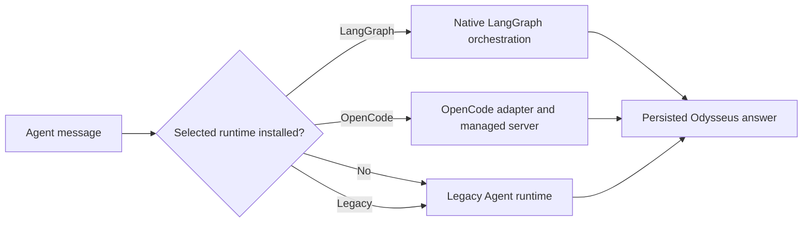

> This repository is a runtime-focused fork of [the original Odysseus project](https://github.com/pewdiepie-archdaemon/odysseus). Read the [upstream README](https://github.com/pewdiepie-archdaemon/odysseus/blob/main/README.md) for the base application's features, deployment choices, and project history. This document covers the runtime upgrades added by this fork.
>
> This repository is a personal modified distribution of Odysseus.
> Public access is provided for evaluation, personal use, and issue reporting.
> Public pull requests are not accepted for this personal fork. Pull requests may be opened only by invited collaborators. Public Issues remain enabled for fork-specific bug reports, questions, and maintenance concerns. General-purpose contributions should be submitted to the original Odysseus repository. Development is maintained by the repository owner.
> This project contains and modifies software licensed under the GNU Affero
> General Public License v3.0. See LICENSE and the upstream attribution notices.

See [NOTICE.md](NOTICE.md) for upstream attribution and information about this modified fork.


# Odysseus Runtime Upgrade

This version preserves the upstream Odysseus workspace and adds two independent Agent runtime choices:

- **LangGraph** — native, durable orchestration for planned work, specialist workers, recovery, and grounded final synthesis.
- **OpenCode** — an adapter to the external OpenCode agent runtime, with one managed native conversation per Odysseus chat and an integrated Session Manager/TUI workflow.

**Legacy** remains the built-in baseline. LangGraph and OpenCode are optional installations: if either is missing, Odysseus still starts, labels that runtime **Not Installed**, disables it in Runtime Settings, and excludes it from the chat quick toggle.

<!-- Suggested image: Runtime Settings showing Legacy, LangGraph, and OpenCode availability. -->

## Quick Startup Guide

### 0. Open the Folder you want the project to install

Following shell commands would be installed in the opened file directory. For example:

```powershell
cd D:\AI\odysseus
```

### 1. Clone this fork

```powershell
git clone https://github.com/Miku5613/odysseus-private-integration.git
cd odysseus-private-integration
```

### 2. Install Odysseus

On Windows, run:

```powershell
& '.\Express Installation.bat'
```

The installer sets up the mandatory Python environment, then separately asks whether to install LangGraph, OpenCode, and upstream optional feature extras. It does **not** install or offer any model library.

To inspect the machine without installing anything:

```powershell
& '.\Verify Files Integrity.bat'
```

### 3. Configure a model provider

Odysseus does not bundle a model. For the quickest local start, this fork recommends [Ollama](https://ollama.com/) because it has a small setup surface. Install it manually on Windows

```powershell
winget install --id Ollama.Ollama -e
```

Ollama is a recommendation, not an Odysseus dependency, and the express installer never installs it. LM Studio or any compatible local/remote provider can be configured instead.

You will also need to download a suitable LLM model for your needs. Check the inbuilt Odysseus cookbook for hardware-specific recommended models directly from HuggingFace. Alternatively, you can download any ollama listed models directly from shell

```powershell
ollama run llama3
```

This installs the specific LLM model llama3 in your Ollama model library, you replace the LLM id with any desired one you want.
### 4. Start Odysseus

```powershell
powershell -ExecutionPolicy Bypass -File .\launch-windows.ps1
```

Open `http://127.0.0.1:7000`, complete the first-admin setup if prompted, add the model endpoint in Settings, and choose a runtime under **Settings → Runtime**.

For Docker, macOS, Linux, HTTPS, and the base application configuration, use the [upstream setup documentation](https://github.com/pewdiepie-archdaemon/odysseus/blob/main/docs/setup.md). Docker is deliberately not installed by the express installer: on Windows its WSL 2/kernel prerequisites can require elevation and a restart, so it is safer as a user-managed, resumable installation rather than a hidden one-shot step.

## Runtime Availability

| Runtime | Installation | What happens when absent |
| --- | --- | --- |
| Legacy | Built into Odysseus; mandatory baseline | Always available |
| LangGraph | Optional Python runtime pack | Shown as **Not Installed** and disabled; Agent requests use Legacy |
| OpenCode | Optional external CLI | Shown as **Not Installed** and disabled; no OpenCode process is started |

Availability means the runtime itself is installed. Model endpoint reachability is checked later when a run is prepared; an installed runtime does not imply that a selected model provider is online.

The backend also enforces these boundaries. A stale browser setting cannot force an unavailable LangGraph runtime, and direct OpenCode runtime requests return a controlled unavailable response when the CLI is missing.

## How Runtime Selection Works

Runtime selection applies to Agent mode. The default is set in **Settings → Runtime**, while each existing chat retains its assigned runtime. The small runtime control beside the composer cycles only through installed runtimes.



Runtime failures stay contained. An OpenCode failure does not silently widen into LangGraph or Legacy. LangGraph can use its configured Legacy fallback only for an eligible failed plan step; it does not restart the entire user query in Legacy.

## LangGraph Runtime

LangGraph is integrated as a native Odysseus orchestration layer rather than a separate UI or server. It uses the active Odysseus model registry, workspace boundary, tools, chat persistence, Server-Sent Events stream, and authentication context.

### Workflow

1. **Admission** decides whether the turn should be answered directly, handled by one specialist, or coordinated as multiple steps.
2. **Planning** produces explicit `PlanStep` contracts, including required sources, dependencies, completion conditions, and intended worker capability.
3. **Resolution** binds each step to an allowed execution surface without silently widening its source authority.
4. **Workers** perform general reasoning, code inspection, knowledge retrieval, research, MCP-specialized work, or web search only when the plan authorizes it.
5. **Verification and replanning** check evidence, semantic completion, dependency results, and retry/replan limits.
6. **Final synthesis** uses the selected synthesis model to write a non-empty user-facing answer from verified worker results.
7. **Checkpointing** stores run state, decisions, step attempts, events, and recovery data in SQLite so interrupted work can be inspected or resumed safely.


### LangGraph settings

The Runtime Settings panel exposes the main product controls:

| Setting group | Available controls |
| --- | --- |
| Execution | Automatic/direct/single-worker/multi-step planning, effort preset, parallel worker limit |
| Permissions | Guided or active action level, per-step Legacy fallback policy, approval before long research |
| Models | One compatible runtime model or role-specific models for planner, general, knowledge, code, research, and final synthesis |
| Recovery | Interrupted-run behavior, completed-run retention, completed-research reuse |
| Context | Conversation, workspace, indexed knowledge, completed research, and personal memory source policy |
| Visibility | Show or hide the Live Task Planner while work is running |

Important operating rules:

- Tool and file authority remains scoped to the selected workspace and the plan contract.
- Public web search is not automatically enabled to rescue a local-file or workspace task.
- Structured admission, supervisor, and planner calls are isolated from user-facing synthesis behavior.
- The final answer is persisted through the normal Odysseus conversation path; internal reasoning is never treated as the user answer.
- Durable recovery uses `data/langgraph/checkpoints.sqlite3` by default and keeps large artifacts in the adjacent LangGraph artifact store.

### Manual LangGraph installation

If it was skipped during express installation:

```powershell
venv\Scripts\python.exe -m pip install -r requirements-langgraph.txt
```

Restart Odysseus, reopen Runtime Settings, and LangGraph becomes selectable.

## OpenCode Runtime

OpenCode is integrated as an external peer runtime. Odysseus manages a loopback `opencode serve` process, translates the active Odysseus endpoint/model into an isolated OpenCode configuration, normalizes OpenCode events into the Odysseus stream, and persists the resulting transcript in the active Odysseus chat.

It does not import LangGraph and does not use LangGraph or Legacy as a hidden fallback.

### Conversation workflow

1. Select **OpenCode** for a new or existing Agent chat.
2. Odysseus resolves the selected endpoint, model, and workspace.
3. The adapter starts or reuses the managed loopback OpenCode server.
4. The chat is bound to a native OpenCode session; reuse/reset behavior follows Runtime Settings.
5. Permission requests, tool activity, todos, deltas, completion, cancellation, and errors are normalized into Odysseus events.
6. The final non-empty answer and native session identifiers are persisted to the Odysseus transcript.


### OpenCode settings and controls

- **Reuse conversation per chat** keeps one native OpenCode session attached to each Odysseus conversation.
- **Reset after switching runtime** starts fresh when a chat leaves OpenCode and later returns.
- **Permission mode** can require approval or grant workspace-scoped operation, while Odysseus still applies its own ownership and workspace checks.
- **Active model and workspace** are passed into the managed OpenCode configuration when the runtime is prepared.
- **Start, stop, restart, health, logs, cancellation, and conversation reset** are exposed through the adapter rather than requiring a separately managed server terminal.

### Session Manager and TUI


The **Open Session Manager** action opens an authenticated native terminal view for the current Odysseus/OpenCode context. It supports:

- inspecting and switching native sessions;
- starting a new session or forgetting a chat binding;
- viewing live status, transcript, todos, and server logs;
- reviewing permission requests and recorded approvals;
- working with OpenCode MCP entries, plugins, extensions, and commands;
- applying lifecycle operations without exposing the managed server outside loopback.

Session Manager control uses a short-lived scoped grant. The managed server defaults to `127.0.0.1:4096`; do not expose it directly to the network without OpenCode server authentication.

### Manual OpenCode installation

If it was skipped during express installation, install the official CLI package:

```powershell
npm install -g opencode-ai
opencode --version
```

Then restart Odysseus. A standalone OpenCode binary may also be used by setting `ODYSSEUS_OPENCODE_EXECUTABLE` to its path. OpenCode itself still needs access to a model provider; the adapter does not install one.

## Added Dependency Inventory

This table intentionally lists only dependencies introduced for this fork’s runtime upgrades. It does not repeat FastAPI, ChromaDB, SearXNG, document tooling, or any other upstream Odysseus dependency.

| Added dependency | Required for | Mandatory? | Installation |
| --- | --- | --- | --- |
| `langgraph==1.2.7` | Native graph execution and orchestration | Optional | `requirements-langgraph.txt` |
| `langchain-core>=1.4.8,<2` | LangGraph message/core contracts | Optional | `requirements-langgraph.txt` |
| `langgraph-checkpoint-sqlite==3.1.0` | Restart-durable SQLite checkpoints | Optional | `requirements-langgraph.txt` |
| OpenCode CLI (`opencode-ai`) | OpenCode runtime, managed server, native sessions, and TUI | Optional | Express opt-in or `npm install -g opencode-ai` |
| Node.js/npm | One supported Windows installation/upgrade path for the OpenCode CLI | Optional | Installed only after approving OpenCode; unnecessary when using a standalone binary |

No model library is an added mandatory dependency. Ollama, LM Studio, OpenCode Zen, and other OpenAI-compatible/local providers are user choices and remain outside express installation.

## Installation Utilities

### `Verify Files Integrity.bat`

Runs a lightweight, non-installing startup simulation. It reports each check as **Installed**, **Not Installed**, **Unreachable**, **Fallback**, or **Configuration**, and labels mandatory versus optional groups. It checks the Python runtime, core imports, required files, data/database readiness, optional LangGraph packages, the OpenCode executable, and supporting tools.

### `Express Installation.bat`

Creates `venv`, installs `requirements.txt`, and runs first-time setup. It then asks separately before installing:

- the LangGraph runtime pack;
- the OpenCode CLI (and Node.js only if that approved path requires it);
- upstream optional document, speech, search, and PDF extras.

It never offers or installs Ollama, LM Studio, another model library, Docker Desktop, WSL, GPU drivers, or vendor API credentials.

## Configuration Reference

Most users should configure runtimes in the UI. These environment variables are useful for advanced OpenCode deployments:

| Variable | Purpose | Default |
| --- | --- | --- |
| `ODYSSEUS_OPENCODE_EXECUTABLE` | OpenCode executable name or absolute path | `opencode` |
| `ODYSSEUS_OPENCODE_URL` | Managed/external OpenCode server URL | `http://127.0.0.1:4096` |
| `ODYSSEUS_OPENCODE_MANAGE_SERVER` | Let Odysseus start and stop OpenCode | `true` |
| `ODYSSEUS_OPENCODE_WORKSPACE` | Fallback workspace for OpenCode | unset |
| `ODYSSEUS_OPENCODE_STARTUP_TIMEOUT` | Managed server startup timeout | `30` seconds |
| `ODYSSEUS_OPENCODE_RUN_TIMEOUT` | Maximum OpenCode run duration | `900` seconds |
| `ODYSSEUS_LANGGRAPH_CHECKPOINT_DB` | Override LangGraph checkpoint database | `data/langgraph/checkpoints.sqlite3` |
| `ODYSSEUS_LANGGRAPH_ARTIFACT_DIR` | Override durable artifact directory | beside the checkpoint database |

## Troubleshooting

- **Only Legacy appears:** run `Verify Files Integrity.bat`. Optional runtimes are disabled until all components for that runtime are detected, then require an Odysseus restart.
- **LangGraph is Not Installed:** install `requirements-langgraph.txt` into the same `venv` used by Odysseus.
- **OpenCode is Not Installed:** confirm `opencode --version` works in a new terminal or set `ODYSSEUS_OPENCODE_EXECUTABLE` explicitly.
- **Runtime installed but model unavailable:** verify the selected provider endpoint and model in Odysseus. Installation status does not probe or install a model server.
- **Docker installation requests a restart:** finish the WSL 2/kernel or Docker Desktop setup, restart Windows, and rerun the Docker setup. The native Windows launcher does not require Docker.

## Upstream, License, and Scope

This fork builds on [Odysseus](https://github.com/pewdiepie-archdaemon/odysseus). Base-product questions and unchanged features should be read alongside the upstream documentation. Runtime-specific behavior described here belongs to this fork.

AGPL-3.0-or-later — see [LICENSE](LICENSE) and [ACKNOWLEDGMENTS.md](ACKNOWLEDGMENTS.md).
